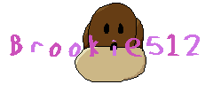
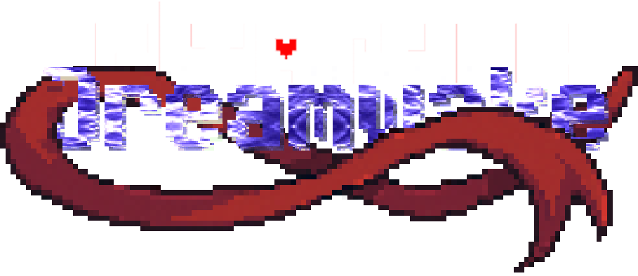
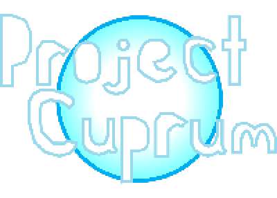

# Tenna Quiz Engine
A custom engine for playing quizzes in the style of DELTARUNE Chapter 3.

## Overview
Tenna Quiz Engine is a quiz engine inspired by DELTARUNE, aiming to mix the style of the quizzes from Chapter 3 with something like Kahoot, where users can create quizzes of their own.

As of current, this project is only available as a windows executable. It will hopefully be ported to the web in the near future, but for now, this is the best I can do.

## See my other projects!

